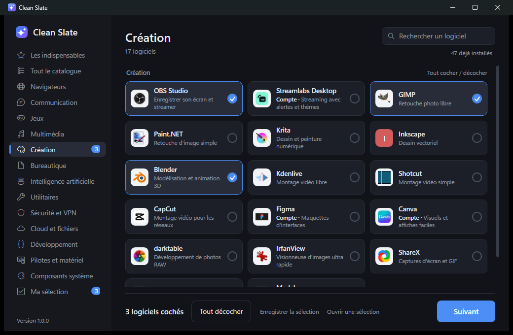

<div align="center">


# Clean Slate

**Un PC neuf, tous tes logiciels, en un clic.**

[](https://github.com/TomRolling/Clean-Slate/releases/latest)
[](https://github.com/TomRolling/Clean-Slate/releases)
[](LICENSE)


[**Télécharger CleanSlate.exe**](https://github.com/TomRolling/Clean-Slate/releases/latest/download/CleanSlate.exe)

</div>

Tu viens d'installer Windows ou d'acheter un PC ? Clean Slate installe d'un coup tous les logiciels dont tu as besoin :
tu coches, tu cliques, il s'occupe du reste. L'interface est en français.



## Ce que ça fait

- **Plus de 220 logiciels rangés par famille** : navigateurs, communication, jeux, multimédia, création, bureautique,
  intelligence artificielle, utilitaires, sécurité et VPN, cloud, développement, pilotes, composants système.
- **Les vrais logos**, une recherche qui comprend aussi les usages (« pdf », « vpn »), et une page « Les indispensables ».
- **Des packs prêts à cocher** : Gamer, Bureautique, Étudiant, Streaming, Développeur.
- **Des applis du Microsoft Store** aussi : WhatsApp, Netflix, Xbox, iCloud…
- **Toujours la dernière version** de chaque logiciel, au moment où tu l'installes.
- **Tu choisis où ça s'installe**, logiciel par logiciel, quand le logiciel le permet. La place libre du disque est affichée.
- **Ce qui est déjà sur le PC est grisé** : rien n'est installé deux fois.
- **Ta sélection se garde dans un fichier**, pour ta prochaine réinstallation de Windows ou pour l'envoyer à un ami.
  Glisse ce fichier sur `CleanSlate.exe` et tout est recoché.
- **Payant, compte à créer, version d'essai** : c'est écrit sur la tuile.
- L'installation se fait toute seule, un logiciel après l'autre. À la fin, tu vois ce qui a réussi et pourquoi le reste
  a échoué, en français.

## Installation

1. Télécharge [`CleanSlate.exe`](https://github.com/TomRolling/Clean-Slate/releases/latest/download/CleanSlate.exe).
2. Lance-le. Il n'y a rien à installer : c'est un seul fichier.

Il faut Windows 10 ou 11, en 64 bits.

**« Windows a protégé votre ordinateur »** — au premier lancement, Windows SmartScreen peut afficher cet écran bleu,
parce que le fichier n'est pas signé par un éditeur payant. Clique sur **Informations complémentaires**, puis sur
**Exécuter quand même**.

Windows demande aussi les droits d'administrateur au lancement : ils servent à installer les logiciels sans te
redemander l'autorisation pour chacun.

## Mises à jour

Clean Slate se met à jour tout seul : au lancement, il regarde si une version plus récente est publiée ici. Si oui,
un encart « Version … disponible » apparaît en bas à gauche ; un clic sur **Mettre à jour** la télécharge, vérifie le
fichier et relance l'appli.

## Bon à savoir

- Les logiciels sont téléchargés par **winget**, l'outil officiel de Microsoft fourni avec Windows, depuis les sites des
  éditeurs. Clean Slate n'héberge aucun logiciel, et winget vérifie l'empreinte de chaque installeur.
- Certains logiciels **imposent leur emplacement** (Chrome, Discord, Spotify…) : pour eux, le choix du dossier n'est pas
  proposé. Les composants système vont toujours sur le disque de Windows.
- Le PC ne **redémarre jamais tout seul** : si un logiciel en a besoin, une fenêtre te le demande à la fin.
- **Pas de pub, pas de collecte de données, rien qui tourne en arrière-plan.** Fermer la fenêtre arrête tout.
- Seuls échanges avec Internet : winget pour télécharger les logiciels, et une question à GitHub au lancement pour
  savoir si une version plus récente de Clean Slate existe.

## Pour les développeurs

C# / WPF / .NET 10, MVVM avec CommunityToolkit.Mvvm.

```powershell
dotnet build
dotnet test                 # catalogue, codes de winget, enchaînement des écrans
.\verifier-catalogue.ps1    # vérifie chaque identifiant winget et la liste des dossiers réglables
.\telecharger-logos.ps1     # récupère le logo des logiciels ajoutés au catalogue
.\publier.ps1               # fabrique le .exe autonome sur ton PC
```

| Où | Quoi |
| --- | --- |
| [`CleanSlate/Services/Catalog.cs`](CleanSlate/Services/Catalog.cs) | Le catalogue : une ligne par logiciel |
| [`CleanSlate/Services/Winget.cs`](CleanSlate/Services/Winget.cs) | Le seul endroit qui parle à winget |
| [`CleanSlate/ViewModels/CatalogueViewModel.cs`](CleanSlate/ViewModels/CatalogueViewModel.cs) | La logique des trois écrans |
| [`CleanSlate/Views/`](CleanSlate/Views/) | Catalogue, « Où installer ? », Installation |
| [`CleanSlate.Tests/`](CleanSlate.Tests/) | Les tests automatiques |

**Ajouter un logiciel** : vérifie son identifiant (`winget show --id Editeur.Logiciel --exact --source winget`), ajoute
une ligne dans `Catalog.cs`, puis lance les deux scripts de vérification.

**Publier une version** : il suffit d'un `git push` sur `main`. GitHub lance les tests, fabrique le `.exe` et crée la
Release ([`publication.yml`](.github/workflows/publication.yml)) ; les applis déjà installées proposent la mise à jour
à leur prochain lancement.

## Licence

[MIT](LICENSE) © Tom Rolling. Les logos et les noms des logiciels appartiennent à leurs éditeurs respectifs.
